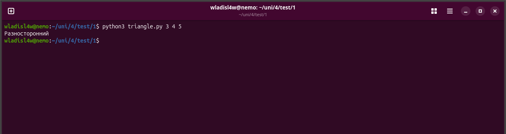
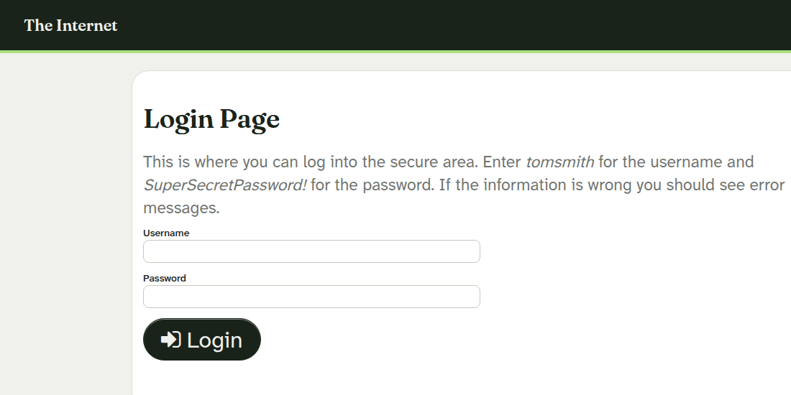
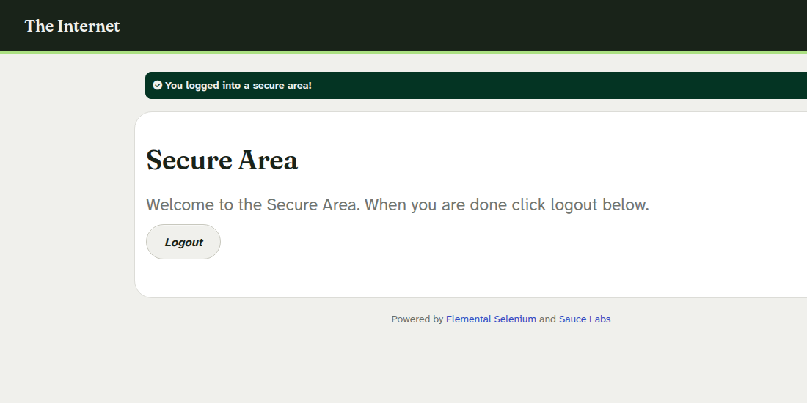
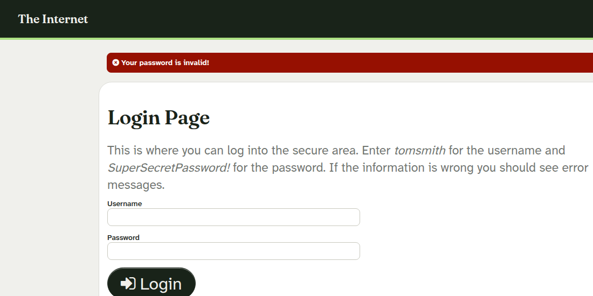

# Лабораторная работа №1. Поиск дефектов и форма входа
Цель: проверить программу определения типа треугольника и составить чек-лист формы входа.
## 1. Программа и её проверки
Я написал triangle.py. Она принимает три стороны, проверяет положительность и неравенство треугольника, затем определяет тип. Десятичные числа обрабатываются через Decimal, чтобы не терять точность при сравнении. Запуск: python3 triangle.py 3 4 5. Результат: Разносторонний.

Таблица 1. Проверки моей программы
| Стороны | Ожидается | Получено | Итог |
| 3, 3, 3 | Равносторонний | Равносторонний | Выполнено |
| 3, 3, 4 | Равнобедренный | Равнобедренный | Выполнено |
| 3, 4, 5 | Разносторонний | Разносторонний | Выполнено |
| 1, 2, 3 | Не треугольник | Не треугольник | Выполнено |
| 0, 2, 2 | Не треугольник | Не треугольник | Выполнено |
| -1, 2, 2 | Не треугольник | Не треугольник | Выполнено |
| 0.0001, 0.00015, 0.0002 | Разносторонний | Разносторонний | Выполнено |
| NaN, 2, 2 | Не треугольник | Не треугольник | Выполнено |
Полный вывод сохранён в triangle-results.txt.
## 2. Независимая программа
Источник: https://github.com/AdTekDev/ASE.SoftwareTesting/blob/main/LABs/W02/Code/PTriangle.py. Копия и ввод сохранены в peer_triangle.py и peer-result.txt. Для сторон 0.0001, 0.00015, 0.0002 программа вывела «Right triangle». Это неверно: квадраты двух меньших сторон дают 3.25·10⁻⁸, квадрат большей стороны равен 4·10⁻⁸. Причина: абсолютное сравнение с допуском 10⁻⁶, который больше обеих величин. Проверка не выполнена.
## 3. Форма входа
Объект: https://the-internet.herokuapp.com/login. Тестовая страница указывает логин tomsmith и пароль SuperSecretPassword!. Для чек-листа разделяю проверки по доступному HTML и требующие действий в браузере. Дата: 01.11.2026, среда: Ubuntu, HTTP-клиент Python requests. Проверки GET и POST сохранены в login-results.txt и login-post-results.txt. После повторной проверки в Google Chrome удалось получить снимки формы и обоих результатов входа. Скриншоты сохранены в screenshots; HTTP-проверки также сохранены отдельно.
Таблица 2. Чек-лист формы входа
| Проверка | Ожидание | Статус |
| Страница /login доступна | HTTP 200 | Выполнено |
| Есть поля username и password | Оба поля присутствуют | Выполнено по HTML |
| Есть кнопка Login | Кнопка присутствует | Выполнено по HTML |
| Поле пароля скрывает ввод | type=password | Выполнено по HTML |
| Есть ссылка восстановления пароля | Ссылка рядом с формой | Нет в HTML, уточнить требования тестовой страницы |
| Курсор в поле логина после открытия | Фокус на логине | Не проверено; снимок не показывает фокус |
| Верные данные tomsmith / SuperSecretPassword! | Переход в /secure | Выполнено через POST |
| Неверный пароль | Сообщение об ошибке | Выполнено через POST |
| Пустые поля | Сообщение об ошибке | Выполнено через POST |
| Несколько ошибочных попыток | Предусмотрена политика ограничения | Не проверено, правило не задано |
| Назад/вперёд после входа | Нет раскрытия защищённой страницы | Не проверено в браузере |

## Вывод
Моя программа прошла 8 проверок. В независимой программе воспроизвёл ошибку на малых длинах. Форма корректно обработала три HTTP-сценария входа. Браузер подтвердил успешный вход и сообщение при неверном пароле. Положение курсора, политика ограничения попыток и история браузера не проверялись.
