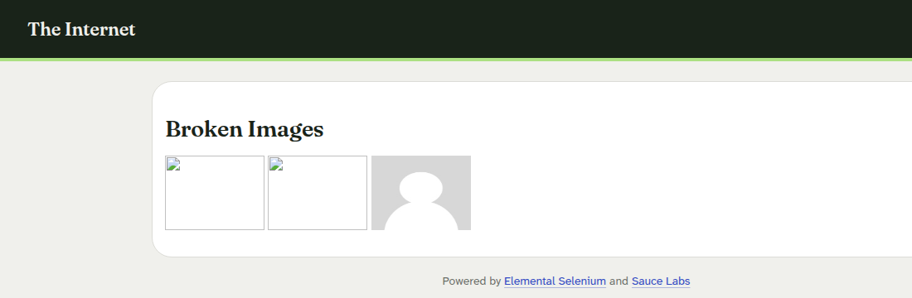
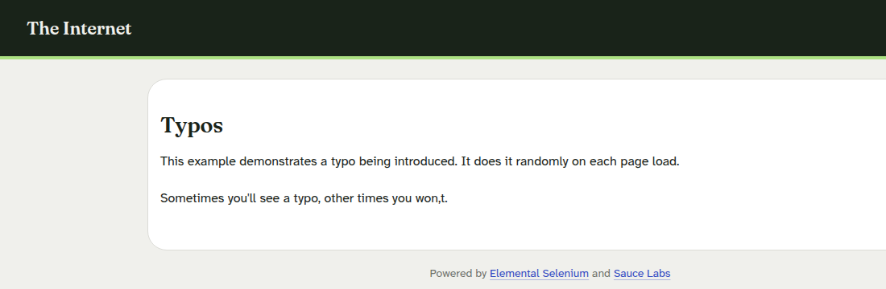
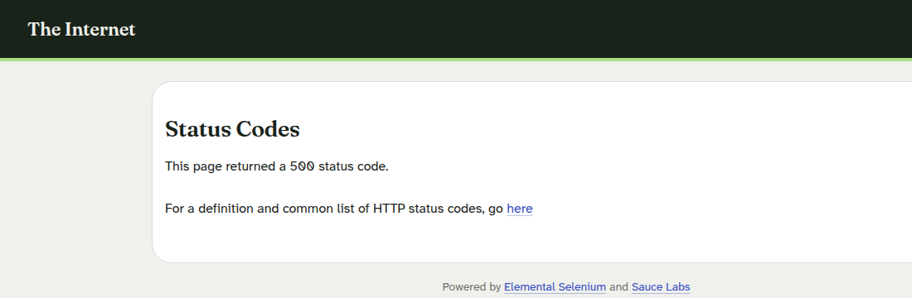

# Лабораторная работа №2. Баг-репорты
Цель: научиться фиксировать воспроизводимые дефекты с серьёзностью и приоритетом.
## 1. Объект и способ проверки
Использован учебный сайт https://the-internet.herokuapp.com/. Он специально содержит демонстрационные ошибки. Проверка выполнена 01.11.2026 из Ubuntu через Python requests; точная версия сайта не опубликована. Файл probe.py повторяет запросы, http-results.txt содержит ответы. HTTP-ответы подтверждены также открытием страниц в Google Chrome. Скриншоты сохранены в screenshots, протокол браузерной проверки: browser-results.txt.
## 2. Баг-репорты
### BUG-01. Первая картинка на странице Broken Images не загружается
Проект: The Internet. Компонент: Broken Images. Версия: не указана. Severity: S4 Minor. Priority: P2 Medium. Статус: Open в учебном отчёте.
Шаги: 1) открыть https://the-internet.herokuapp.com/broken_images; 2) запросить адрес первой картинки из основного блока: https://the-internet.herokuapp.com/asdf.jpg.
Ожидается: сервер отдаёт изображение с успешным кодом. Фактически: HTTP 404, Content-Type text/html. Доказательство: строка image 2 в http-results.txt и снимок страницы ниже.

### BUG-02. На странице Typos случайно появляется опечатка
Проект: The Internet. Компонент: Typos. Версия: не указана. Severity: S5 Trivial. Priority: P3 Low. Статус: Open в учебном отчёте.
Шаги: открыть https://the-internet.herokuapp.com/typos несколько раз.
Ожидается: фраза заканчивается «won't». Фактически: в 4 из 8 сохранённых запросов появилось «won,t» с запятой вместо апострофа. Доказательство: typos-runs.txt и снимок ниже. Дефект намеренно внесён в учебный сайт.

### BUG-03. Демонстрационная страница статуса 500 возвращает ошибку сервера
Проект: The Internet. Компонент: Status Codes. Версия: не указана. Severity: S3 Major для обычного продукта, учебная демонстрация. Priority: P3 Low для учебного сайта. Статус: Open в учебном отчёте.
Шаги: открыть https://the-internet.herokuapp.com/status_codes/500.
Ожидается: прикладная страница отвечает без серверной ошибки. Фактически: HTTP 500. Доказательство: строка /status_codes/500 в http-results.txt, HTTP 500 при открытии в браузере и снимок ниже.

Здесь ошибка создана намеренно для тренировки; исправлять её на учебном сайте не требуется.
## Вывод
Три разных вида ошибки воспроизведены запросами: отсутствующее изображение, опечатка и ответ сервера 500. Приоритет отделён от серьёзности: намеренная ошибка на учебном сайте не мешает его основному назначению.
