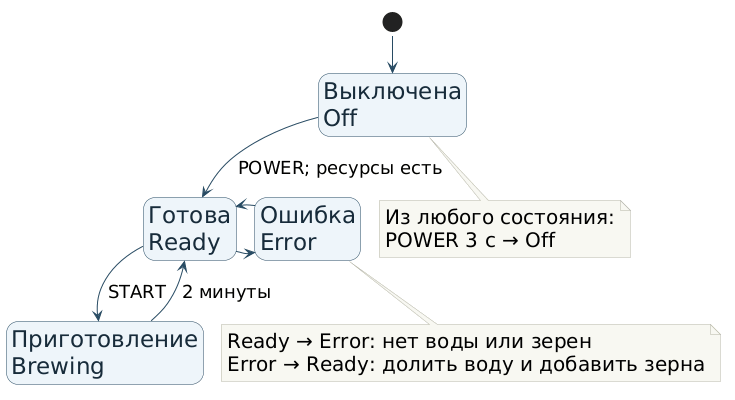

# Лабораторная работа № 5
## Тема: комбинаторное тестирование и диаграмма состояний
## Задание
Для конфигуратора ноутбука рассчитать число допустимых сочетаний и составить оптимальный попарный набор с учётом ограничений. Для умной кофемашины построить диаграмму и таблицу переходов, разработать пять критичных и два неочевидных теста.
## Ход выполнения
### Задание 1. Комбинаторное тестирование конфигуратора ноутбука
Варианты выбора: процессор — Intel i5, Intel i7, AMD Ryzen 7; ОЗУ — 8, 16, 32 ГБ; накопитель — SSD 256 ГБ, SSD 512 ГБ, SSD 1 ТБ, HDD 1 ТБ; видеокарта — интегрированная, NVIDIA GTX 1650, NVIDIA RTX 3060.
Полный перебор: 3 × 3 × 4 × 3 = 108 конфигураций. Запрет Intel i5 + 32 ГБ ОЗУ исключает 1 × 1 × 4 × 3 = 12. HDD 1 ТБ доступен только с Intel i5 или AMD Ryzen 7, поэтому Intel i7 + HDD исключает 1 × 3 × 1 × 3 = 9. Эти группы не пересекаются: процессор не может быть одновременно i5 и i7. Допустимы 108 − 12 − 9 = 87 конфигураций.
Условие «интегрированная видеокарта и NVIDIA RTX 3060 не могут быть выбраны одновременно» не даёт дополнительного вычитания: видеокарта — одно поле с одним значением. Если в реальном конфигураторе разрешён выбор двух видеокарт, модель параметров и расчёт потребуется уточнить.
#### Оптимальный попарный набор
Таблица 1. Конфигурации для проверки
| № | Процессор | ОЗУ | Накопитель | Видеокарта |
|---|---|---|---|---|
| 1 | Intel i5 | 8 ГБ | SSD 512 ГБ | NVIDIA RTX 3060 |
| 2 | Intel i5 | 8 ГБ | SSD 1 ТБ | NVIDIA GTX 1650 |
| 3 | Intel i5 | 16 ГБ | SSD 256 ГБ | Интегрированная |
| 4 | Intel i5 | 16 ГБ | HDD 1 ТБ | NVIDIA GTX 1650 |
| 5 | Intel i7 | 8 ГБ | SSD 256 ГБ | NVIDIA RTX 3060 |
| 6 | Intel i7 | 16 ГБ | SSD 512 ГБ | NVIDIA GTX 1650 |
| 7 | Intel i7 | 32 ГБ | SSD 1 ТБ | Интегрированная |
| 8 | AMD Ryzen 7 | 8 ГБ | HDD 1 ТБ | Интегрированная |
| 9 | AMD Ryzen 7 | 16 ГБ | SSD 1 ТБ | NVIDIA RTX 3060 |
| 10 | AMD Ryzen 7 | 32 ГБ | SSD 256 ГБ | NVIDIA GTX 1650 |
| 11 | AMD Ryzen 7 | 32 ГБ | SSD 512 ГБ | Интегрированная |
| 12 | AMD Ryzen 7 | 32 ГБ | HDD 1 ТБ | NVIDIA RTX 3060 |
Каждая строка — отдельный тест: указанные четыре значения должны выбираться и сохраняться вместе. По всем 87 допустимым конфигурациям возможна 61 пара значений параметров; набор покрывает 61 из 61. Точный поиск минимального покрытия дал нижнюю и верхнюю границы 12, разрыв 0 %. Следовательно, 12 тестов — доказанный минимум для этой модели. Расчёт и набор воспроизводятся скриптом make_pairs.py; итог сохранён в coverage.txt и pairwise.csv. Рабочий конфигуратор не предоставлен, фактическое прохождение не заявляется.
### Задание 2. Диаграмма состояний кофемашины
Состояния: Off (выключена), Ready (готова), Brewing (приготовление), Error (ошибка). Стрелки рисунка показывают заданные переходы. Удержание POWER 3 секунды переводит в Off из любого состояния, включая Off. Редактируемый исходник диаграммы PlantUML сохранён в coffee-states.puml; изображение для отчёта построено из него.

#### Таблица переходов
Таблица 2. Переходы и события, нуждающиеся в уточнении
| Исходное | Событие и условие | Следующее | Ожидаемый результат |
|---|---|---|---|
| Off | Короткое POWER; вода и зерна есть | Ready | Машина готова |
| Ready | START | Brewing | Приготовление началось |
| Brewing | Прошло 2 минуты | Ready | Приготовление завершено |
| Ready | Нет воды или зерен | Error | Показана ошибка |
| Error | Долита вода и добавлены зерна | Ready | Ошибка снята |
| Off | POWER 3 секунды | Off | Остаётся выключенной |
| Ready | POWER 3 секунды | Off | Выключилась |
| Brewing | POWER 3 секунды | Off | Приготовление прервано |
| Error | POWER 3 секунды | Off | Выключилась |
| Off | Короткое POWER; нет воды или зерен | Не задано | Уточнить реакцию |
| Error | START без устранения причины | Не задано | Уточнить режим и сообщение |
| Brewing | START повторно | Не задано | Уточнить реакцию |
| Brewing | Открыт отсек для воды | Не задано | Уточнить реакцию |
Пример таблицы в теоретической части методички добавляет Off + POWER без ресурсов → Error и Error + POWER при ресурсах → Ready, а также Ready + таймаут → Ready. В явном перечне переходов задания этих правил нет; приоритет отдан перечню задания. Для них нужны уточнения. Повторная ошибка Error → Error приведена среди критичных примеров, но событие и реакция в перечне переходов не заданы.
#### Пять критичных сценариев
1. К1, основной путь. При наличии воды и зерен нажать POWER, затем START, выждать 2 минуты и удержать POWER 3 секунды. Ожидается Off → Ready → Brewing → Ready → Off. Проверяется возможность приготовить напиток и завершить работу.
2. К2, восстановление. В Ready исчерпать воду; затем долить воду и добавить зерна. Ожидается Ready → Error → Ready. Проверяется защита от работы без ресурсов и возврат к работе.
3. К3, аварийное выключение. Во время Brewing удержать POWER 3 секунды. Ожидается Brewing → Off и прекращение приготовления. Проверяется безопасное прерывание.
4. К4, повторная ошибка. Перевести Ready → Error отсутствием воды, не устраняя причину, повторно нажать START. Приготовление не должно начинаться; переход Error → Error и точное сообщение указаны лишь как пример, поэтому требуют подтверждения требований. Риск — запуск без воды.
5. К5, граничное событие. В Ready нажать START в тот же момент, когда заканчиваются зерна. Возможны конкурирующие события Ready → Brewing и Ready → Error; их порядок и конечное состояние не заданы. Требуется уточнить приоритет ошибки. Риск — небезопасное приготовление.
#### Два неочевидных теста
1. Н1. Во время Brewing повторно нажать START. Проверить, что не начинается второе приготовление; конкретная реакция и сообщение не заданы и требуют уточнения.
2. Н2. Во время Brewing открыть отсек для воды, затем удержать POWER 3 секунды. Итог после длительного POWER — Off по заданному правилу; промежуточная реакция на открытие отсека не задана и требует уточнения.
Сценарии спроектированы по условию. Устройство или работающее приложение не предоставлено; результатов запуска и скриншотов нет.
## Вывод
Из 108 конфигураций допустимы 87; оптимальный набор из 12 тестов покрывает все 61 допустимую пару. Для кофемашины построены диаграмма, таблица переходов и семь сценариев; пробелы требований отмечены отдельно.
