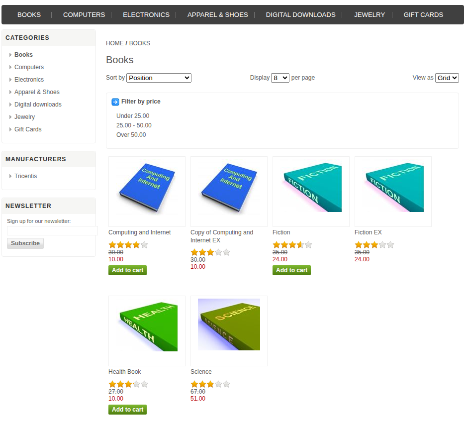
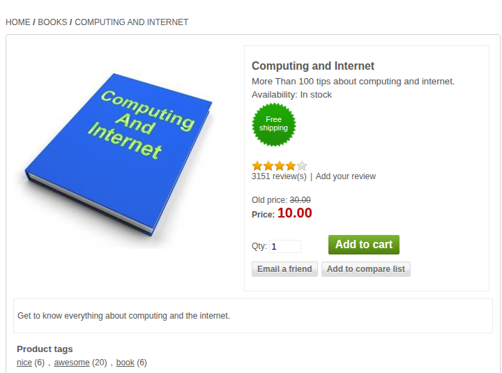
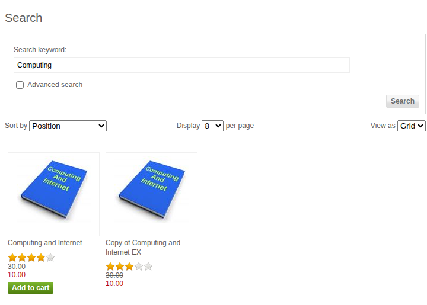

# Лабораторная работа № 6
## Тема: сценарное и исследовательское тестирование
## Задание
Для интернет-магазина выполнить три задачи из перечня методички и описать подробные сценарии с ожидаемыми и фактическими результатами. Выбраны задачи № 1 «Ориентирование в категориях каталога», № 6 «Изучение страницы с подробным описанием товара» и № 37 «Свободный поиск товара».
## Ход выполнения
Объект проверки — Demo Web Shop, https://demowebshop.tricentis.com/. Дата: 03.11.2026. Среда: Ubuntu; действия выполнены в браузере Codex In-app Browser, страницы дополнительно сняты собственным Google Chrome в режиме headless при размере окна 1366 × 1100. Версия магазина на сайте не указана. Исходные снимки лежат в screenshots/*-view.png, в отчёт включены фрагменты этих снимков без изменения содержимого. Запись действий — browser-results.txt, дополнительные HTTP-ответы — http-results.txt.
### Задача № 1. Ориентирование в категориях каталога
Предусловие: открыта главная страница магазина https://demowebshop.tricentis.com/.
Шаги:
1. Найти в верхнем меню ссылку BOOKS.
2. Нажать BOOKS.
3. Проверить заголовок категории, адрес страницы и наличие товаров.
Ожидаемый результат: открывается категория Books; заголовок и товары соответствуют категории.
Фактический результат: переход открыл https://demowebshop.tricentis.com/books с заголовком «Demo Web Shop. Books». На странице видны шесть карточек: Computing and Internet, Copy of Computing and Internet EX, Fiction, Fiction EX, Health Book и Science. Дополнительный HTTP-запрос к странице вернул 200.
Итог: сценарий пройден в обозначенных пределах. Снимок показывает меню, заголовок и карточки; удобство поиска категории человеком не оценивалось.

### Задача № 6. Изучение страницы с подробным описанием товара
Предусловие: открыта категория Books; в списке есть товар Computing and Internet.
Шаги:
1. Найти карточку Computing and Internet.
2. Нажать название товара.
3. Проверить адрес, название, описание, наличие и цену на подробной странице.
Ожидаемый результат: открывается отдельная страница выбранного товара с его названием и ценой.
Фактический результат: открылась https://demowebshop.tricentis.com/computing-and-internet. Видны название Computing and Internet, описание, отметка In stock, прежняя цена 30.00 и текущая цена 10.00. Дополнительный HTTP-запрос вернул 200 и цену 10.00.
Итог: сценарий пройден. Покупка и изменение количества товара не выполнялись.

### Задача № 37. Свободный поиск товара
Предусловие: открыта страница товара; в верхней части страницы доступна строка Search store.
Шаги:
1. Ввести Computing в верхнюю строку поиска.
2. Нажать Search.
3. Проверить поисковый запрос, адрес страницы и названия найденных товаров.
Ожидаемый результат: открывается выдача по запросу Computing; среди результатов есть товары с этим словом в названии.
Фактический результат: открыт адрес https://demowebshop.tricentis.com/search?q=Computing. В поле Search keyword отображается Computing. Выданы два товара: Computing and Internet и Copy of Computing and Internet EX. Дополнительный HTTP-запрос вернул 200 и те же два названия.
Итог: сценарий пройден через интерфейс. Проверка релевантности других запросов в него не входила.

### Исследовательские наблюдения
Во время прохождения задач обнаружено, что из карточки категории можно перейти на подробную страницу товара, а поиск с этой страницы приводит к отдельной выдаче. На странице товара одновременно показаны старая и текущая цены; в поиске есть два близких по названию товара. Эти наблюдения подсказали дополнительные проверки цены и различимости карточек, но они не выполнялись и дефектами не считаются.
## Вывод
Три задачи выполнены в браузере; результаты подтверждены собственными снимками и дополнительной HTTP-проверкой.
